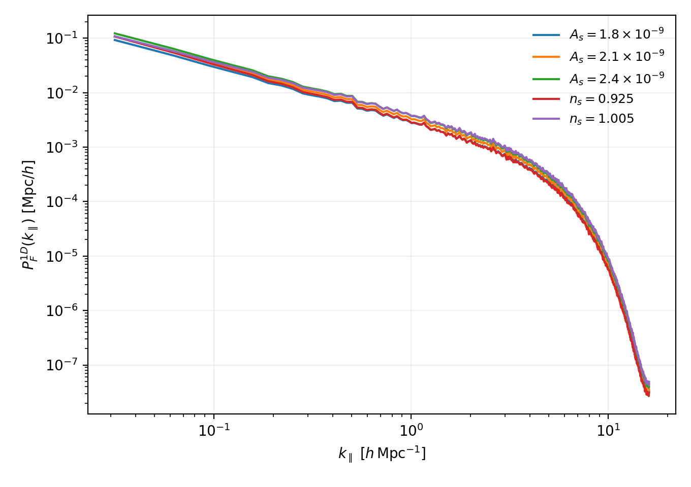

# mini-p1d

`mini-p1d` is a compact, standalone prototype for the pipeline

```text
tabulated CDM P3D
  -> rescale As, ns, and linear growth
  -> analytic matter P1D projection
  -> Gaussian 1D density skewers
  -> optional pressure smoothing
  -> lognormal gas density
  -> FGPA optical depth
  -> optional supplied RSD displacement and thermal smoothing
  -> transmitted flux
  -> measured flux P1D
```

It is deliberately smaller than LyaCoLoRe.  It accepts a two-column matter
power table directly and does not require CoLoRe, FITS, HEALPix, or survey
catalogues.




## Scientific scope

- Wavenumbers are in `h/Mpc`.
- Input `P3D` is in `(Mpc/h)^3`.
- Output `P1D` is in `Mpc/h`.
- Independent 1D skewers are suitable for testing an approximate P1D pipeline.
- They do **not** reproduce cross-skewer or full 3D correlations.
- The CLI does not generate peculiar velocities.  The Python API accepts an
  externally supplied displacement field in pixel units.
- The built-in demonstration spectrum is not a precision CLASS/CAMB spectrum.

## Install

From this directory:

```bash
python -m venv .venv
source .venv/bin/activate
python -m pip install --upgrade pip
python -m pip install -e ".[test]"
```

On a machine where build dependencies are already installed and network
access is restricted, use:

```bash
python -m pip install --no-build-isolation -e ".[test]"
```

Run the tests:

```bash
pytest -q
```

## Run the self-contained demonstration

```bash
mini-p1d \
  --output output_demo \
  --redshift 3.0 \
  --As 2.1e-9 \
  --ns 0.965 \
  --length 200 \
  --npix 1024 \
  --nskewers 512 \
  --mean-flux 0.80 \
  --gamma 1.5 \
  --thermal-sigma 1.0
```

The command writes:

```text
output_demo/mini_p1d_results.npz
output_demo/diagnostic.png
output_demo/summary.txt
```

## Make comparison plots

The example below varies `As` and `ns` while keeping the random seed, mean
transmitted flux, FGPA slope, skewer length, and numerical resolution fixed:

```bash
python examples/compare_cosmologies.py --output comparison_plots
```

It creates:

- `matter_power_comparison.png`: the input three-dimensional matter power and
  its projected matter P1D;
- `flux_p1d_comparison.png`: the approximate FGPA transmitted-flux P1D.

For faster exploratory plots, reduce the number of skewers:

```bash
python examples/compare_cosmologies.py \
    --output quick_plots \
    --nskewers 128 \
    --npix 512
```

The comparison script uses the internal demonstration spectrum. For a
scientific comparison, run `mini-p1d` separately on CLASS/CAMB tables and plot
the saved arrays from each `mini_p1d_results.npz` file.

The redshift argument is metadata: redshift evolution must be supplied through
a table evaluated at that redshift or through `--growth-ratio`, together with
the corresponding mean flux and IGM parameters.

## Run with a real CLASS/CAMB table

Prepare a whitespace-delimited file with columns

```text
k [h/Mpc]    P_m(k,z_fid) [(Mpc/h)^3]
```

and run:

```bash
mini-p1d \
  --pk-file fiducial_pk_z3.dat \
  --As-fid 2.1e-9 \
  --ns-fid 0.965 \
  --As 2.15e-9 \
  --ns 0.970 \
  --growth-ratio 1.0 \
  --redshift 3.0 \
  --mean-flux 0.80 \
  --output output_real
```

`--growth-ratio` means `D(z)/D(z_fid)`.  Use `1` when the table is already at
the requested redshift.

The default pivot is `0.05/0.674 h/Mpc`, corresponding to a primordial pivot
of `0.05 1/Mpc` for `h=0.674`.  Override it with `--kpivot` when needed.

## Python API

```python
import numpy as np
from mini_p1d import TabulatedMatterPower, PipelineConfig, run_pipeline

table = np.loadtxt("fiducial_pk_z3.dat")
power = TabulatedMatterPower(
    table[:, 0],
    table[:, 1],
    As_fid=2.1e-9,
    ns_fid=0.965,
    kpivot_hmpc=0.05 / 0.674,
)

config = PipelineConfig(
    redshift=3.0,
    As=2.15e-9,
    ns=0.970,
    growth_ratio=1.0,
    length_mpch=200.0,
    n_pixels=1024,
    n_skewers=512,
    target_mean_flux=0.80,
    gamma=1.5,
    thermal_sigma_pixels=1.0,
)

result = run_pipeline(power, config)
print(result["fgpa_A"], result["mean_flux"])
```

## RSD hook

If a velocity calculation supplies a displacement in pixels for every cell,
with the same shape as the generated skewer array, pass it as

```python
result = run_pipeline(power, config, displacement_pixels=displacement)
```

For comoving coordinates `x` in Mpc/h, a physical line-of-sight velocity can
be converted schematically through

```text
Delta x [Mpc/h] = h * v_parallel [km/s] / (a H(z) [km/s/Mpc])
displacement_pixels = Delta x / pixel_size
```

Generating a self-consistent velocity field requires a 3D density
realisation and is intentionally outside this first standalone version.

## References and limitations

See [REFERENCES.md](REFERENCES.md) for the origin of the FGPA and lognormal
relations, related public software, and the present model limitations.

## License

MIT. See [LICENSE](LICENSE).

